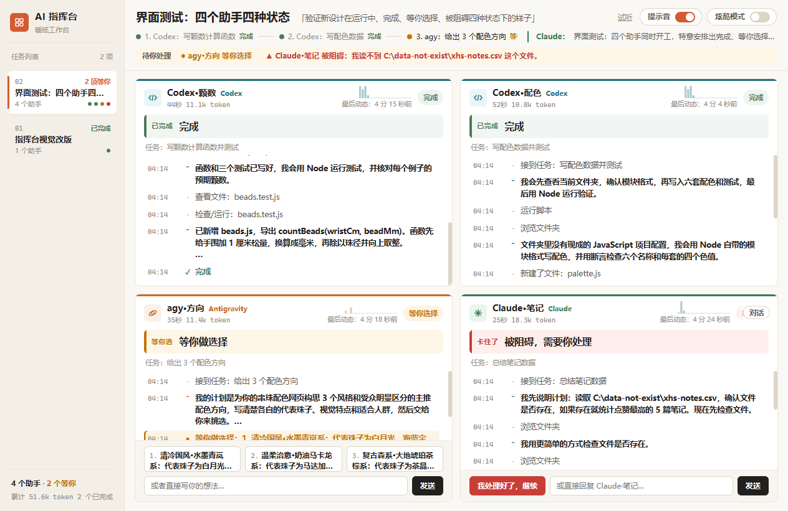
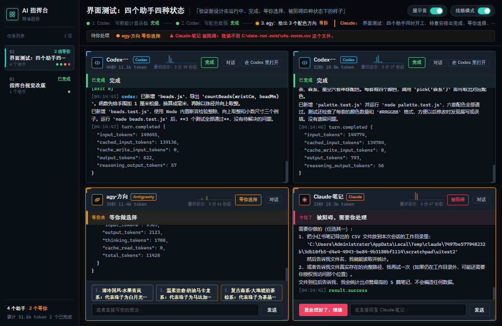

# AI指挥台

**你只跟 Claude 说需求，Claude 当总指挥，把活派给 Codex、Antigravity 和其他 Claude 助手；这个桌面小程序像监控墙一样，用大白话实时显示每个助手正在做什么。**

适合看不懂代码、但同时开着几个 AI 会员、想让它们分工合作的个人创作者。



---

## 它解决什么问题

同时用好几个 AI 编程助手时，常见的麻烦是：

- 交代完任务就**看不到它们在干什么**，做到哪一步了、有没有跑偏，全靠等结果
- 助手遇到登录、缺权限这类小障碍，会**自己换路线**，最后交回来的东西不是你要的
- 每个助手在各自的程序里，**来回切换很累**

AI指挥台的做法：

- **只有一个入口**：你只在 Claude Code 里说需求，拆任务、派活、审查都由 Claude 来做
- **一屏看全部**：每个助手一块固定大小的画面，所有画面同时可见，像监控室一样
- **说人话**：显示的是"正在打开小红书""新建了文件 beads.js"，而不是代码
- **跑偏会提醒**：访问了任务范围外的网站、改了任务文件夹以外的文件，画面会标黄并弹出系统通知
- **卡住会停下**：遇到登录、缺插件这类问题，助手停下来告诉你要做什么，而不是绕路
- **随时插手**：在画面里直接回复它、点选项、停止它，或者打开聊天窗口跟它对话

## 功能一览

| 功能 | 说明 |
|---|---|
| 监控墙 | 每个助手一块画面，按数量自动排成 1～4 列；每块画面里的记录在块内自己滚动，不会把其他画面挤下去 |
| 大白话动态 | 把助手的每个动作翻译成一句话：查看文件、修改文件、网上搜索、打开网页、运行测试…… |
| 计划进度 | 顶部显示你的原话、Claude 拆出的步骤，以及每一步做到哪了 |
| 跑偏提醒 | 可设置每个任务的网站范围，超出就标黄提醒；改动任务文件夹以外的文件也会提醒 |
| 被阻碍 / 等你选择 | 助手停下来时画面变黄；需要你选择时，选项直接变成按钮 |
| 回复和继续 | 在画面底部回复它，它会**接着原来的对话**继续，不用从头开始 |
| 聊天窗口 | 右侧滑出聊天界面，显示和某个助手的完整来往 |
| 炫酷模式 | 整个窗口换成深色「静谧舰桥」风格，每块画面只留一行进展，下面滚动显示它**真实在跑的**命令、输出和代码 |
| 活跃度波形 | 每块画面一条小柱状图，显示它最近 5 分钟的忙碌程度；旁边显示「最后动态：12 秒前」，运行中超过 3 分钟没动静会变黄提醒 |
| 看看卡哪了 | 助手很久没动静时，一键检查它到底在干什么：在等 AI 服务器回复、在本机干活，还是在等一个停不下来的程序。卡住时可以一键结束那个程序或重启它接着做 |
| 全局总览 | 左下角随时显示「4 个助手 · 1 个运行中 · 2 个等你」和累计用量 |
| 提示音 | 完成一项是轻快的「叮～咚」，卡住或等你选择是低沉的「咚…咚」，全部完成是一串庆祝琶音；可试听、可关闭 |
| 系统通知 | 可能跑偏、被阻碍、等你选择、完成时，弹出 Windows 通知 |
| 打开原程序 | Codex 的对话可以一键在 Codex 桌面版里打开；Claude 侧边栏会话可以一键在 Claude 程序里打开 |



## 工作方式

```
  你 ──说需求──▶ Claude Code（总指挥）
                    │  拆任务、写计划、派活、审查
                    ▼
              dispatch.mjs（调度器）
        ┌───────────┼───────────────┐
        ▼           ▼               ▼
      Codex        agy        Claude 助手 / 侧边栏会话
        │           │               │
        └─── 实时事件翻译成大白话，写进 runs/<任务>/ ───┘
                    │
                    ▼
           AI指挥台窗口（监控墙）◀── 你在这里看、回复、停止
```

- 调度器启动的是各家**官方命令行程序**，用的是你自己已登录的账号，请求直接发给各家官方服务器，**没有中转**
- 所有记录只保存在本机的 `runs/` 文件夹里，指挥台不连接任何外部服务器

## 准备工作

| 需要 | 说明 |
|---|---|
| Windows 10 / 11 | 目前只在 Windows 上测试过 |
| [Node.js](https://nodejs.org/) 18 或更新 | 运行调度器和窗口 |
| [Git](https://git-scm.com/) | 克隆项目；助手写代码时也用它管理改动 |
| [Claude Code](https://docs.claude.com/en/docs/claude-code) | 总指挥。桌面版或命令行版都可以，需要已登录 |
| [Codex CLI](https://github.com/openai/codex) | `npm i -g @openai/codex`，并登录一次 |
| Antigravity CLI（`agy`） | 按 Google 官方说明安装，并登录一次 |
| Google Chrome（可选） | 让 agy 浏览需要登录的网站时使用，见下方「让 agy 使用你的 Chrome」 |

不用的助手可以不装，只是派不了那一类活。

## 安装

```powershell
git clone https://github.com/sumian-buff/ai-command-center.git
cd ai-command-center
npm install
npm run shortcut
```

`npm run shortcut` 会在桌面创建 **AI指挥台** 快捷方式。双击就能打开窗口；不打开也没关系，派活时会自动弹出来。

## 让 Claude 学会用它

Claude 需要知道"派活要通过指挥台"。把 [`docs/CLAUDE.example.md`](docs/CLAUDE.example.md) 里的内容复制到 Claude Code 的全局规则文件里：

```
%USERPROFILE%\.claude\CLAUDE.md
```

然后把里面所有的 `<AI指挥台目录>` 换成你实际的项目路径。之后在**任何项目文件夹**里开 Claude Code，它都会按这套方式工作。

## 日常使用流程

1. **在 Claude Code 里说需求**，像平时一样，比如"做一个能挑串珠配色的网页，顺便看看小红书上流行什么配色"
2. **Claude 拆任务、派活**。指挥台窗口自动弹出，顶部是你的原话和计划步骤，下面每个助手一块画面
3. **看着它们干活**。每块画面最上面一行是"它现在在做什么"，下面是它做过的每一步
4. **需要你的时候，画面会变黄**，同时弹出系统通知：
   - **等你选择**：点画面底部的选项按钮
   - **被阻碍**：看它说需要你做什么，比如登录某个网站，处理好后点「让它继续」
   - **可能跑偏**：看提醒内容，觉得不对就点「停止」，再回到 Claude 对话里说明
5. **完成后**，Claude 会审查所有改动，在对话里向你汇报结果、问题和下一步建议

小事（回答问题、改一两行）Claude 会自己直接做，不会派活，指挥台也不会弹出来。想让它一定走派活流程，可以直接说"派给 Codex"或"用指挥台做"。

## 画面说明

每块画面从上到下：

| 位置 | 内容 |
|---|---|
| 标志和颜色 | 是谁：青色 `</>` 是 Codex，橙色轨道是 Antigravity，绿色星芒是 Claude（炫酷模式下换成对应的亮色） |
| 标题栏 | 名字、用时、用了多少 token、活跃度波形、最后动态、状态。鼠标移到画面上时会出现「对话」「停止」等按钮 |
| 醒目的那一条 | **它此刻正在做什么**，颜色表示状态：绿色正在做、黄色等你、红色卡住、灰绿完成 |
| 任务 | 派给它的一句话任务 |
| 动态记录 | 它做过的每一步，最新的在最下面。往上翻看旧记录时不会被新动态打断，有新内容时会提示「有新动态 ↓」 |
| 底部（需要时才出现） | 选项按钮、回复框、「让它继续」 |

**炫酷模式**：右上角开关。打开后整个窗口变成深色，每块画面只留一行大白话进展，下面滚动显示它真实在跑的命令、输出和写进文件的代码。助手停下时画面也会停，不会用假数据装作在跑。

**提示音**：右上角开关，点「试听」可以依次听到三种声音。声音是程序现场合成的，不需要音频文件。

视觉设计由 Antigravity 出方案、Claude 审阅后实现，两轮方案的样板页和截图在 [`design/`](design/) 文件夹里。

## 遇到情况怎么办

| 情况 | 做法 |
|---|---|
| 要你做选择 | 点画面底部的选项，或在回复框里写你的想法（回车发送） |
| 想跟它多聊几句 | 点「对话」，右侧打开聊天窗口 |
| 要你登录网站 | agy 会在你的 Chrome 里打开登录页并停下。你在 Chrome 里登录，然后点「让它继续」 |
| 觉得它跑偏了 | 点「停止」，回到 Claude 对话里说明哪里不对，由 Claude 重新安排 |
| 它很久没动静 | 运行中超过 3 分钟没动静，画面底部会出现「看看卡哪了」（鼠标移到画面上也随时能点）。检查几秒后会告诉你是哪种情况：**在等 AI 服务器回复**（再等等）、**在本机干活**（再等等）、**在等一个不会结束的程序**（点「结束这个程序」，它就能接着做）、**真的卡住了**（点「重启它，接着做」，之前做好的部分不会丢） |
| 想在 Codex 自己的程序里看 | 点「在 Codex 里打开」，会跳到 Codex 桌面版里的这段对话 |
| Claude 侧边栏会话需要你 | 点「在 Claude 里打开」，在 Claude 程序里直接回复它 |
| 其他卡住的问题 | 回到 Claude 对话里说，由 Claude 在后台处理 |

你在指挥台里回复助手的内容不会自动通知 Claude。按规则模板，Claude 下次回答你之前会先查看一遍指挥台的最新状态。

## 让 agy 使用你的 Chrome

agy 的浏览器功能是通过 Chrome 的远程调试连接**你平时用的 Chrome**，所以能用你已经登录的网站。

1. 打开 Chrome，地址栏输入 `chrome://inspect/#remote-debugging`，打开远程调试开关
2. 第一次被连接时 Chrome 可能弹窗询问，点允许
3. 让 agy 做网页任务时，**Chrome 要开着**

> ⚠️ **风险提醒**：远程调试开着的时候，你电脑上的**任何程序**都能控制你的 Chrome，包括你登录着的所有网站。建议只在需要时打开，用完关掉。
>
> 用你的账号让 AI 浏览网站，也可能触发网站的风控。调度器已要求 agy 只浏览、不互动（不点赞、不评论、不关注、不购买），但请控制使用频率。

## 命令参考

这些命令主要给 Claude 用。你一般不需要手动运行，排查问题时可能用得上。

```powershell
# 查看最近任务的状态汇总
node dispatch.mjs status

# 手动打开指挥台窗口（已开着就不会重复打开）
node dispatch.mjs ensure

# 派活
node dispatch.mjs run --run <任务ID> --agent codex|agy|claude --name <显示名> --task <一句话任务> `
  --cwd <工作目录> --prompt-file <提示文件> [--sites 域名1,域名2] [--browser] [--step N] [--readonly]

# 接着对话继续 / 打开它自己的程序 / 停止
node dispatch.mjs resume --run <任务ID> --name <名字> (--text <话> | --message-file <文件>)
node dispatch.mjs open   --run <任务ID> --name <名字> [--terminal]
node dispatch.mjs stop   --run <任务ID> --name <名字>

# 计划步骤和 Claude 的说明
node dispatch.mjs step --run <任务ID> --n <步骤号> --status todo|doing|done|blocked
node dispatch.mjs note --run <任务ID> --text <说明>

# Claude 侧边栏会话：生成任务说明，用 Claude Code 的 start_session 开会话后，再登记
node dispatch.mjs brief  --run <任务ID> --name <名字> --prompt-file <提示文件>
node dispatch.mjs attach --run <任务ID> --name <名字> --session <local_会话编号> --cwd <会话目录> [--task …] [--step N]
```

计划文件格式（`runs/<任务ID>/plan.json`）：

```json
{
  "title": "串珠配色网页",
  "request": "用户的原话",
  "steps": [
    { "text": "Codex：做配色预览网页", "owner": "Codex", "status": "todo" },
    { "text": "agy：调研小红书流行配色", "owner": "Antigravity", "status": "todo" }
  ]
}
```

## 文件结构

```
ai指挥台/
├── dispatch.mjs            调度器：启动助手、翻译事件、检查跑偏、接着对话继续
├── app/
│   ├── main.js             窗口主程序：读取记录、系统通知、停止 / 打开等操作
│   ├── renderer.js         界面：监控墙、聊天窗口、炫酷模式
│   ├── sound.js            提示音（现场合成）
│   ├── diagnose.js         看看卡哪了：检查进程、子程序、CPU 和网络连接
│   ├── transcript.js       读取 Claude 侧边栏会话的记录文件
│   ├── preload.js
│   ├── index.html
│   └── style.css
├── scripts/
│   └── create-shortcut.mjs 创建桌面快捷方式
├── docs/
│   ├── CLAUDE.example.md   给 Claude 的全局规则模板
│   └── *.png               截图
├── design/                 视觉设计的要求、两轮样板页和预览图
└── runs/                   任务记录（只存在本机，不会上传）
    └── <任务ID>/
        ├── plan.json        计划
        ├── notes.jsonl      Claude 的说明
        └── agents/<名字>/
            ├── meta.json    状态、对话编号、用量
            ├── events.jsonl 大白话动态
            ├── raw.log      原始记录（炫酷模式用）
            └── result.md    最终回复
```

## 数据与隐私

- 所有记录只保存在本机 `runs/` 文件夹，`.gitignore` 已排除它，不会被上传
- 指挥台窗口不联网；调度器只在本机启动各家官方程序
- 助手处理任务时，你的需求和相关文件会发送给对应的 AI 服务商，这是使用这些服务本身的行为，与指挥台无关

## 已知限制

- 只在 Windows 上测试过
- agy 在无人值守模式下不能运行终端命令，需要运行命令的活应该派给 Codex
- agy 的浏览器操作由它的"浏览器子助手"完成，指挥台只能看到"下达了指令"，具体点击过程请直接看 Chrome 窗口
- Antigravity 桌面版和 agy 命令行各自保存对话记录，所以 agy 的任务不会出现在 Antigravity 桌面版的侧边栏里
- Claude 侧边栏会话由 Claude 程序自己运行，指挥台只能读取它的进度，不能在指挥台里停止它或回复它
- 命令行工具的输出格式如果在新版本里改变，大白话翻译可能需要跟着调整

## 开源协议

[MIT](LICENSE)
